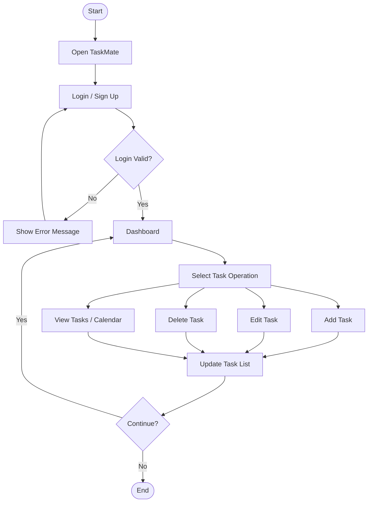

# TaskMate – Workflow Diagram

## 1. Workflow Overview

The workflow describes how a user interacts with the TaskMate Task Management System.

## 2. Workflow Steps

1. Start the application.
2. Display the Login or Sign Up page.
3. User enters login details.
4. Validate the login details if authentication is implemented.
5. Display the Dashboard.
6. User selects a task operation.
7. Add, edit, delete, or view tasks.
8. Update task status and due dates as supported.
9. Display updated task information.
10. User continues managing tasks or exits the application.

## 3. Workflow Diagram

## 4. Conclusion

This workflow represents the planned user journey in TaskMate, from opening the application to managing tasks. The final workflow should be updated to match the implemented prototype.
